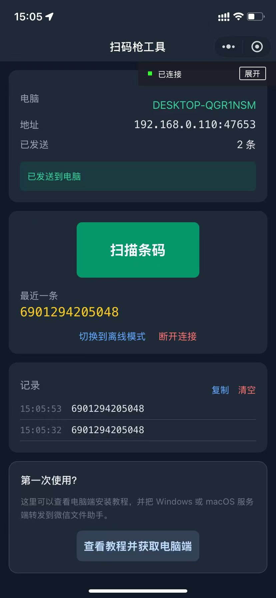
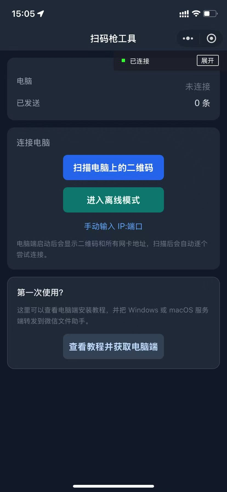
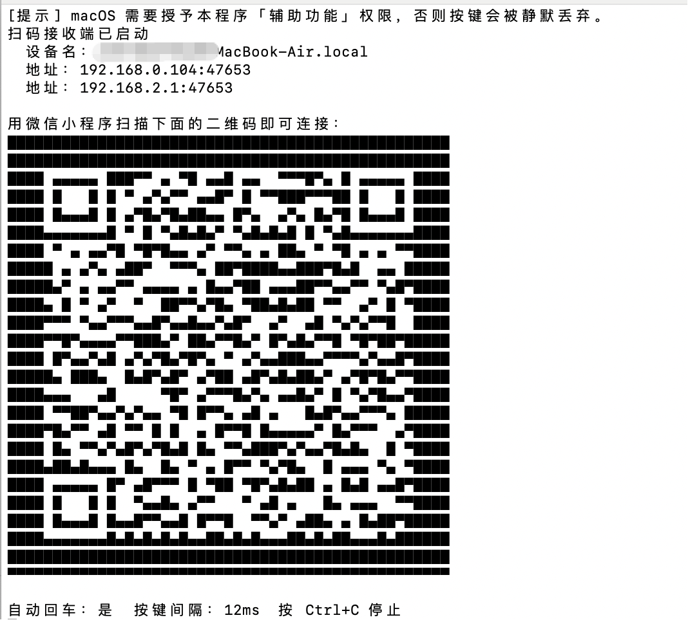
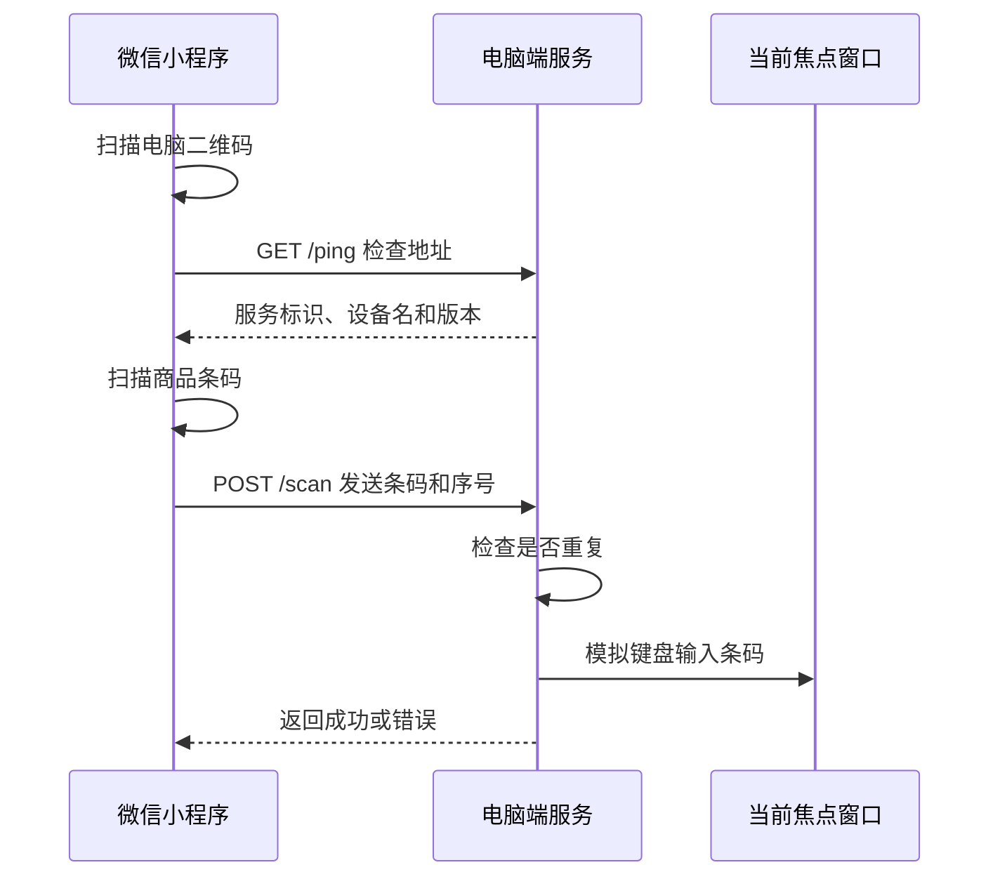

# WeChat-Barcode-Scanner

**手机微信小程序扫码，电脑当前光标位置自动输入条码。**

电脑端支持 Windows 和 macOS，手机端支持 iOS 和安卓。手机和电脑连接同一个
Wi-Fi 或局域网即可，不需要蓝牙，也不需要把条码上传到云端。

| 小程序：已连接 | 小程序：未连接 / 离线入口 | 电脑端 |
| --- | --- | --- |
|  |  |  |

GitHub 开源地址：

```text
https://github.com/1127426159/WeChat-Barcode-Scanner
```

开源许可和第三方组件致谢见
[THIRD_PARTY_NOTICES.md](THIRD_PARTY_NOTICES.md)。

## 版本与系统要求

当前版本：**v0.1.23**

| 项目 | 要求 |
| --- | --- |
| 手机 | 安装较新版本微信，支持真机扫码 |
| 手机系统 | iOS 或 Android |
| Windows 10 / 11 | 支持 Python 3.7+；找不到 Python 时自动安装 Python 3.11.9 |
| Windows 7 / 8 / 8.1 | 自动安装 Python 3.8.10 |
| macOS 11 或更高 | 支持 Python 3.7+；找不到 Python 时自动安装 Python 3.11.9 |
| 网络 | 电脑和手机连接同一个局域网；首次安装依赖需要联网 |
| 磁盘空间 | 至少预留 300 MB 给 Python、虚拟环境和依赖 |

### Windows 7

当前版本会自动识别 Windows 7、Windows 8 和 Windows 8.1，并安装最后一个支持
这些系统的 Python 3.8.10。直接运行 `START-FOR-WINDOWS.bat` 即可。

如果自动安装失败，可以手动安装：

```text
Python 3.8.10（64 位 Windows 7）
https://www.python.org/ftp/python/3.8.10/python-3.8.10-amd64.exe
```

安装时请勾选：

```text
Add Python 3.8 to PATH
```

安装完成后重新打开命令提示符或重新启动电脑，再运行：

```text
START-FOR-WINDOWS.bat
```

Windows 7 已经停止官方维护，可能存在证书、TLS、安全支持和依赖兼容问题，
建议升级到 Windows 10 或 Windows 11。macOS 11 以下系统如需运行，请在系统中
手动准备 Python 3.7 或更高版本，再执行 `START-FOR-MAC.command`。

## 它能做什么

- 微信小程序直接扫描一维条码、二维码、Data Matrix 和 PDF417。
- 扫描内容通过局域网发送到电脑。
- 电脑端把它输入到当前选中的输入框，相当于自动帮你“敲键盘”。
- 支持扫码记录、复制记录、自动回车和连续扫码。
- 支持离线模式，不连接电脑也能扫码、记录和复制条码。
- 电脑存在多个网卡时，小程序会逐个尝试可连接的局域网地址。

## 下载

请从 [GitHub Releases](https://github.com/1127426159/WeChat-Barcode-Scanner/releases/latest)
下载一个通用服务端包：

```text
WeChat-Barcode-Scanner.zip
```

同一个包同时支持 Windows 和 macOS：

| 你的电脑 | 解压后双击哪个文件 |
| --- | --- |
| Windows 用户 | `START-FOR-WINDOWS.bat` |
| macOS 用户 | `START-FOR-MAC.command` |

> 第一次启动会自动创建运行环境并安装依赖。电脑没有安装 Python 时，启动脚本会自动
> 下载安装 Python；macOS 安装时可能需要输入一次管理员密码。需要能访问 Python
> 官方下载地址和依赖源。

如果只需要小程序源码，也可以下载完整源码，或者直接使用仓库中的
[`miniprogram`](miniprogram) 目录。

### 直接从小程序获取服务端

小程序已经内置一个同时支持 Windows 和 macOS 的服务端包。打开小程序底部的
“查看教程并获取电脑端”，点击“转发通用服务端”，然后：

1. 在微信转发面板中选择“文件传输助手”。
2. 在电脑微信中打开“文件传输助手”。
3. 点击刚转发的服务端文件并下载。
4. 解压后双击启动脚本。

这样不需要在手机浏览器里下载文件，也不需要另外把文件从手机传到电脑。

## 离线模式

只使用手机的扫码和记录功能时，不需要启动电脑端，也不需要连接同一个局域网。

1. 在小程序首页点击“进入离线模式”。
2. 点击“扫描条码”正常扫码。
3. 结果会显示在“最近一条”和“记录”中，可以继续扫码、复制或清空。
4. 需要发送到电脑时，点击“改为连接电脑”再扫描电脑二维码。

离线模式下不会调用电脑接口，不会发送任何条码数据。扫码记录和其他模式一样显示在
当前页面，最多保留最近 30 条。

## 三步开始使用

### 第一步：启动电脑端

**Windows**

1. 解压通用服务端压缩包。
2. 双击 `START-FOR-WINDOWS.bat`。
3. 第一次运行时等待依赖安装完成。
4. 如果 Windows 防火墙弹窗，请允许 Python 访问“专用网络”。

如果电脑没有 Python，启动脚本会自动选择兼容版本并尝试安装。

**macOS**

1. 解压通用服务端压缩包。
2. 双击 `START-FOR-MAC.command`。
3. 第一次打开时，如果提示“Apple could not verify”，先点“完成”，再到
   “系统设置 → 隐私与安全性”，在“安全性”区域点击“仍要打开”。
4. 按终端里的提示，为终端授予“辅助功能”权限。

如果当前 macOS 的提示框里没有“打开”或“仍要打开”，请在解压后的文件夹打开终端，
运行：

```bash
xattr -dr com.apple.quarantine .
chmod +x START-FOR-MAC.command start-mac.command start.sh setup_env.sh
sh START-FOR-MAC.command
```

这组命令同时处理“无法验证开发者”和“没有适当访问权限”两个问题。
通用服务端包内还提供了 `MACOS-无法打开请看.txt`，可以直接按照文件中的步骤操作。

如果电脑没有 Python，启动脚本会从 Python 官网下载官方 universal2 安装包，
并通过 macOS 安装器安装；此时需要输入一次管理员密码。

电脑端启动后会显示设备名、IP 地址和端口。Windows 会自动打开一张清晰的二维码图片，
macOS 会直接在终端显示二维码。

### 第二步：准备微信小程序

1. 打开微信开发者工具。
2. 选择“导入项目”。
3. 项目目录选择仓库中的 `miniprogram` 文件夹。
4. 首次使用前，将 `project.config.example.json` 复制为 `project.config.json`。
   该配置使用 `touristappid` 占位，不会包含真实 AppID。
5. 在开发者工具中选择自己的小程序 AppID，开发测试也可以选择测试号。
6. 在开发者工具的“详情 → 本地设置”中勾选“不校验合法域名”。
7. 点击“真机预览”，用手机微信打开预览版小程序。

仓库忽略本地 `project.config.json` 和 `project.private.config.json`，
因此不会保存或提交真实 AppID。

### 第三步：连接并使用

1. 确认手机和电脑连接同一个局域网。
2. 在小程序里点击“扫描电脑上的二维码”。
3. 扫描 Windows 自动打开的二维码图片，或 macOS 终端里的二维码。
4. 在电脑上点一下准备接收文字的输入框。
5. 在小程序里点击“扫描条码”。
6. 扫描成功后，条码会自动输入到电脑当前光标位置。

如果二维码不方便扫描，也可以在小程序中选择“手动输入 IP:端口”，
例如：

```text
192.168.0.108:47653
```

## 工作原理

可以先把它理解成一条很短的家庭局域网消息：

```text
手机扫码
   ↓
微信小程序拿到条码文字
   ↓ 局域网 HTTP
电脑端收到文字
   ↓
模拟键盘输入到当前输入框
```

完整流程如下：



### 1. 电脑端启动一个局域网服务

电脑端程序会在本机启动一个 HTTP 服务，默认监听 `47653` 端口。
它不是网站，只负责接收同一局域网里微信小程序发来的条码。

### 2. 二维码里保存的是连接方式

电脑终端显示的二维码并不保存网址，而是一段连接信息，主要包含：

- 电脑名称
- 端口号
- 电脑所有可能被手机访问的局域网 IP

电脑有 Wi-Fi、有线网、虚拟网卡或 VPN 时，可能同时存在多个 IP。
小程序会逐个尝试，找到第一个能够连接的地址并保存下来。

### 3. 小程序先确认对方真的是扫码接收端

小程序会请求电脑的 `/ping` 接口。电脑返回的服务标识必须等于：

```text
WeChat-Barcode-Scanner
```

这样既能检查网络是否通，也能避免把条码误发给局域网里的其他设备。

### 4. 扫码后把文字发送给电脑

每次扫码，小程序都会向电脑的 `/scan` 接口发送：

- 条码内容
- 本次扫码的随机序号

电脑端在 1.5 秒内发现相同序号时，会认为这是网络重试，不会重复输入。

### 5. 电脑模拟键盘输入

电脑端不会修改目标软件的数据，它只是向“当前拥有焦点的窗口”发送键盘事件：

- Windows：优先使用 `pyautogui`，必要时使用原生 `SendInput`，支持中文和特殊字符。
- macOS：使用 `pyautogui` 或 Quartz `CGEvent`，因此需要“辅助功能”权限。

这就是为什么扫码前必须先点选准备接收文字的输入框。

### 数据去了哪里

条码只在本机局域网内传输，不会经过本项目的云端服务器。
电脑端只保存最近一条状态；小程序中的扫码记录保留在当前页面并限制为最近 30 条。

## 目录结构

```text
WeChat-Barcode-Scanner/
├── host/                电脑端 Python 服务
│   ├── main.py          启动入口
│   ├── server.py        /ping、/scan、/status 接口
│   ├── keyboard.py      模拟键盘输入
│   ├── netinfo.py       查找本机局域网地址
│   └── config.py        配置读取和保存
├── miniprogram/         微信小程序源码
│   ├── assets/server/   内置的 Windows/macOS 通用服务端包
│   └── pages/help/      小程序内使用说明
├── docs/images/         README 截图
├── start.bat            Windows 内部启动脚本
├── bootstrap.bat        Windows 只安装依赖
├── START-FOR-WINDOWS.bat Windows 用户请双击这个文件
├── setup_windows.cmd    Windows 共享初始化逻辑
├── install_python.ps1   Windows 自动安装 Python
├── start-mac.command    macOS Finder 双击启动
├── START-FOR-MAC.command macOS 用户请双击这个文件
├── start.sh             macOS 终端启动
├── bootstrap.sh         macOS 只安装依赖
├── setup_env.sh         macOS 环境初始化
└── requirements.txt     Python 依赖
```

发布包由 [tools/build_server_packages.py](tools/build_server_packages.py)
统一生成。推送 `v*` 标签后，GitHub Actions 会自动创建 Release。

## 常见问题

### 小程序显示“连接超时”

按顺序检查：

1. 电脑端终端是否仍在运行。
2. 手机和电脑是否连接同一个路由器或同一个局域网。
3. 手机是否连接了访客 Wi-Fi；访客网络通常不能访问电脑。
4. 路由器是否开启了“AP 隔离”。
5. 电脑防火墙是否允许 Python 接收局域网连接。
6. 小程序里的 IP 和端口是否与电脑终端显示的完全一致。

如果电脑端运行在 VMware、VirtualBox 等虚拟机里，虚拟机“NAT”网卡地址通常无法被
手机访问。请把虚拟机网络改为“桥接模式”，重启电脑端后再扫描新生成的二维码，
或者直接在宿主机运行电脑端。

Windows 防火墙可以这样放行：

1. 打开“Windows 安全中心”。
2. 进入“防火墙和网络保护”。
3. 点击“允许应用通过防火墙”。
4. 找到 Python，勾选“专用网络”。

如果之前点了“取消”或“阻止”，Windows 会记住拒绝结果，之后不会再弹窗。
这时可以在“高级安全 Windows Defender 防火墙 → 入站规则”中删除 Python 的阻止规则，
或者新建一条允许 TCP `47653` 端口的入站规则。

### 小程序提示“目标不是扫码接收端”

小程序和电脑端版本可能不一致。改名后服务标识为
`WeChat-Barcode-Scanner`，请同时更新两端，重启电脑端并重新扫码连接。

### 手机已经显示成功，但电脑没有输入

- 扫码前没有点选目标输入框。
- 目标程序以管理员权限运行，而电脑端是普通权限。请也用管理员权限启动电脑端。
- macOS 没有给终端或程序授予“辅助功能”权限。
- 个别程序漏字时，可以增大按键间隔，例如：

```text
start.bat --delay 30
```

### 没有看到二维码

Windows 默认使用图片查看器打开二维码，因此不再依赖 CMD 的字符渲染。
如果图片没有自动打开，可以双击终端打印的图片路径。二维码功能依赖 `segno`；
离线安装失败时不影响使用，此时可以在小程序中手动输入终端打印的 `IP:端口`。

### 连接成功后过一段时间又断开

电脑 IP 可能是自动分配的，重启路由器后地址会变化。请让电脑和小程序重新扫码连接，
或者在路由器中为电脑设置固定局域网 IP。

## 启动参数

| 参数 | 作用 |
| --- | --- |
| `--port 47653` | 指定服务端口 |
| `--name "收银台"` | 设置手机里显示的电脑名称 |
| `--no-enter` | 扫码后不自动回车 |
| `--delay 20` | 每个字符之间的间隔，单位是毫秒 |
| `--test "ABC123"` | 不启动服务，只向当前窗口输入测试文字 |

Windows 示例：

```bat
start.bat --name "收银台" --port 47653 --delay 20
```

macOS 示例：

```bash
./start.sh --name "收银台" --port 47653 --delay 20
```

## 接口说明

| 方法 | 路径 | 作用 |
| --- | --- | --- |
| `GET` | `/ping` | 检查服务是否可用，并确认它是扫码枪电脑端 |
| `POST` | `/scan` | 接收 `{"code":"条码内容","seq":"本次序号"}` |
| `GET` | `/status` | 查看设备名、最近条码、成功数量和最近错误 |

## 安全与限制

- 本项目只适用于可信局域网，电脑端不应直接暴露到公网。
- 条码会输入到当前焦点位置，扫码期间不要切换窗口。
- 微信小程序正式发布版要求 HTTPS 和已备案域名；本项目的 HTTP 局域网直连
  适合开发、内部使用和真机调试，不适合直接作为公开小程序上线。
- Python 3.7 和 3.8 已停止官方维护，虽然本项目支持，但建议使用新版本。

## 联系作者

使用问题、功能建议或合作咨询，可以发送邮件到：

```text
wechat_scanner@163.com
```

## 开发者运行

Windows：

```bat
python -m venv .venv
.venv\Scripts\python.exe -m pip install -r requirements.txt
.venv\Scripts\python.exe -m host
```

macOS：

```bash
python3 -m venv .venv
.venv/bin/python -m pip install -r requirements.txt
.venv/bin/python -m host
```

项目版本记录见 [CHANGELOG.md](CHANGELOG.md)。
